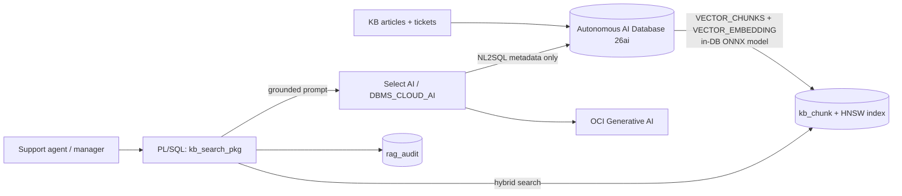
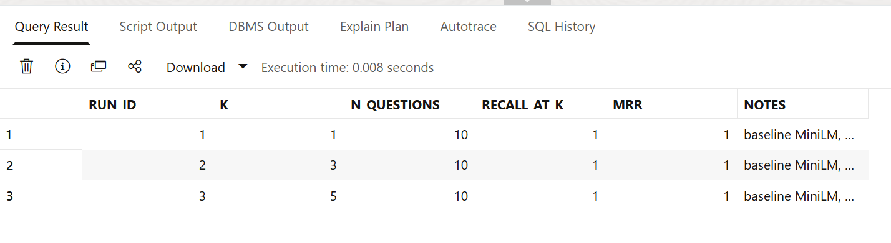
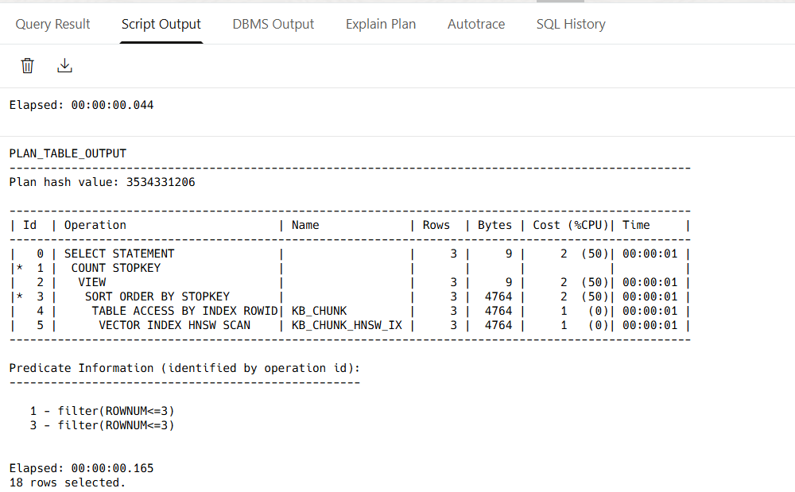
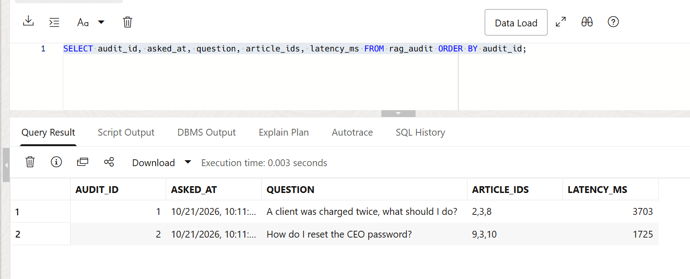
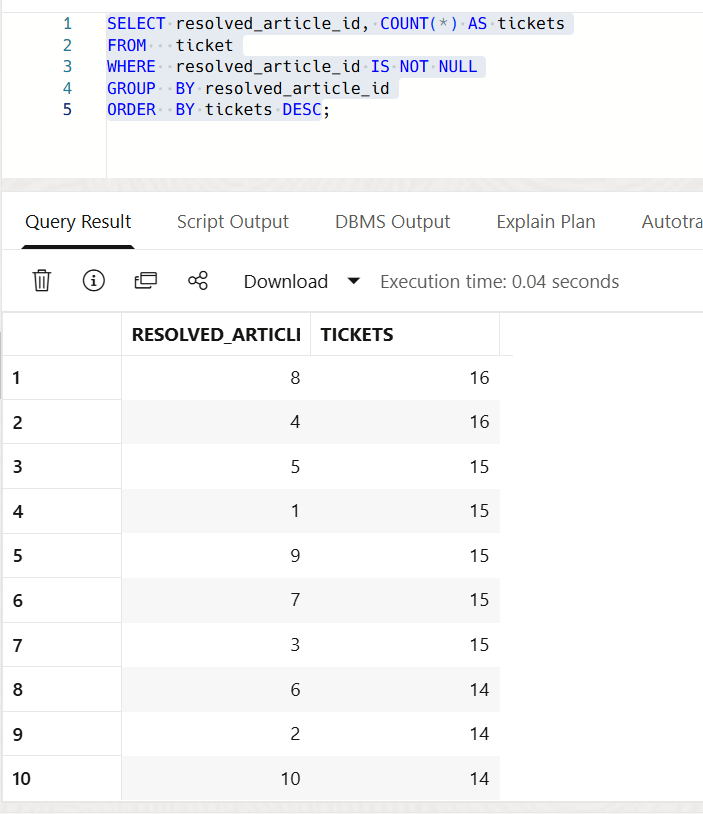

# Support Intelligence on Oracle AI Database 26ai
**AI Vector Search + Select AI + OCI Generative AI, built with SQL and PL/SQL**

Demo video (3 min): <LINK>

A small but complete data + AI solution: structured support tickets and unstructured knowledge-base articles
live in one Oracle schema. Support agents ask questions in plain English and get answers grounded in the
knowledge base, with citations. Managers query ticket data in natural language. Data stays in the database;
SQL and PL/SQL do most of the work; OCI Generative AI is used for language generation.

*Tested on Oracle Autonomous AI Database 26ai (Always Free tier) with OCI Generative AI in Frankfurt, October 2026. All data is synthetic.*

## What it demonstrates

| Capability | Where | Why it matters |
|---|---|---|
| Converged data model (relational + CLOB + `VECTOR`) | `sql/01_schema.sql` | One security model and one place for backup and HA, no separate vector database |
| In-database ONNX embeddings (`DBMS_VECTOR`, `VECTOR_EMBEDDING`) | `sql/03_embeddings.sql` | Data does not leave the database, no per-call embedding cost |
| Set-based ingestion with `VECTOR_CHUNKS` | `sql/03_embeddings.sql` | Chunking and embedding in one SQL statement |
| HNSW vector index, `FETCH APPROX` | `sql/03_embeddings.sql` | Approximate search; plan shows the index is used |
| Hybrid retrieval (semantic + relational filter) | `kb_search_pkg.search` | Real queries mix meaning and structured filters |
| RAG with grounding, citations and a refusal path | `kb_search_pkg.answer` | Reduces hallucination |
| Select AI natural language to SQL | `sql/05_select_ai_oci_genai.sql` | Metadata-only, limited object list |
| Retrieval evaluation (Recall@k, MRR) | `kb_search_pkg.run_eval` | Makes changes measurable |
| Audit trail of generated answers | `rag_audit` | Traceability to source articles |

## Architecture



Design decisions and limitations: [docs/ARCHITECTURE.md](docs/ARCHITECTURE.md).

## Results

### Retrieval evaluation
| Run | k | Questions | Recall@k | MRR | Notes |
|---|---|---|---|---|---|
| 1 | 1 | 10 | 1.000 | 1.000 | baseline MiniLM, 100-word chunks |
| 2 | 3 | 10 | 1.000 | 1.000 | baseline MiniLM, 100-word chunks |
| 3 | 5 | 10 | 1.000 | 1.000 | baseline MiniLM, 100-word chunks |

Perfect scores on a 10-article knowledge base show the pipeline works end to end. They are a baseline, not
proof of production quality: the set is small and the questions share vocabulary with the articles.



The optimizer uses the HNSW index for similarity search:



### RAG answer with citation, and refusal
The model answers only from retrieved context and cites the source. When the knowledge base has no answer it says so.


### Audit trail
Every generated answer is stored with its question, source article ids and latency.



### Select AI: a finding worth checking
I asked which article resolved the most tickets. Select AI answered with article 4 (16 tickets). My own query showed
a tie: articles 4 and 8 both have 16. The answer was correct but incomplete, so generated answers need checking
against hand-written SQL.




## Run it yourself

1. Create an Always Free Autonomous AI Database, version 26ai ([docs/OCI_SETUP.md](docs/OCI_SETUP.md)).
2. As `ADMIN`, run `sql/00_admin_setup.sql`.
3. As `SUPPORT_AI`, run `01_schema.sql` and `02_seed_data.sql`.
4. Upload Oracle's pre-built all-MiniLM-L12-v2 ONNX file to an Object Storage bucket, create a short-lived
   pre-authenticated request, and run `03_embeddings.sql` (it copies the file to `DATA_PUMP_DIR` and loads it).
5. Run `04_kb_search_pkg.sql` and `06_evaluate.sql`. These steps need no LLM and cost nothing.
6. Optional, uses OCI Generative AI (check current pricing and your region): create an API key, fill in the
   placeholders in `05_select_ai_oci_genai.sql`, and run the demo queries.

**Security:** this repository contains no keys, OCIDs or customer data. Use placeholders, never commit a filled-in
`05` script, delete API keys and pre-authenticated requests when finished, and treat any key pasted into a chat or
file as leaked.

## What I learned

Real problems I hit and fixed are in [docs/LESSONS_LEARNED.md](docs/LESSONS_LEARNED.md): a column too short for an
enum value, `VECTOR_CHUNKS` output columns, `COUNT` on a `VECTOR`, a key and fingerprint mismatch, and DML inside a
query (autonomous transaction).

## Next steps (not done yet)

1. Larger document set and harder, indirectly worded test questions.
2. Compare OCI Generative AI embeddings with the in-database ONNX model on Recall@k and cost.
3. Hybrid keyword (Oracle Text) plus vector ranking.
4. Row-level security so agents only see their product's content.
5. APEX front end; Terraform for the OCI resources.

## Repo layout

```
sql/   00 admin setup . 01 schema . 02 seed . 03 embeddings+index . 04 PL/SQL package . 05 Select AI . 06 evaluation
docs/  ARCHITECTURE.md . OCI_SETUP.md . CONSULTANT_PLAYBOOK.md . LEARNING_PATH.md . LESSONS_LEARNED.md . img/
```


