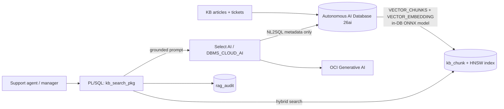

# Support Intelligence on Oracle AI Database 26ai (Select AI + AI Vector Search + OCI Generative AI)

A small but complete **data + AI** solution built the way an Oracle consultant would build it: the
data stays in the database, SQL/PL/SQL does the heavy lifting, OCI services are used where they add value,
and quality, security and cost are measured rather than assumed.

**Scenario.** A (fictional) SaaS vendor has structured support tickets and unstructured knowledge-base articles.
Goal: let agents ask questions in plain English, get grounded answers with citations, and let managers
query ticket data in natural language, all without moving data out of Oracle.

## What it demonstrates

| Capability | Where | Why a hiring manager cares |
|---|---|---|
| Converged data model (relational + CLOB + `VECTOR`) | `sql/01_schema.sql` | Oracle's core AI pitch: no separate vector DB |
| In-database ONNX embeddings (`DBMS_VECTOR`, `VECTOR_EMBEDDING`) | `sql/03_embeddings.sql` | Data never leaves the DB; no per-call API cost |
| Set-based ingestion with `VECTOR_CHUNKS` | `sql/03_embeddings.sql` | Pipeline in one SQL statement |
| HNSW vector index, `FETCH APPROX` | `sql/03_embeddings.sql` | Scale and performance awareness |
| Hybrid retrieval (semantic + relational filter) | `kb_search_pkg.search` | Real enterprise queries mix both |
| RAG with grounding, citations, refusal behaviour | `kb_search_pkg.answer` | Hallucination control |
| **Select AI** NL2SQL on OCI Generative AI | `sql/05_select_ai_oci_genai.sql` | Core Oracle AI product, least-privilege object list |
| Retrieval evaluation (Recall@k, MRR) | `kb_search_pkg.run_eval`, `sql/06_evaluate.sql` | Most candidates skip this; consultants must prove it works |
| Audit trail of every generated answer | `rag_audit` | Governance and compliance |
| Architecture, security, cost, rollout thinking | `docs/` | The actual consulting skill |

## Architecture



## Quick start (about 2 hours, Always Free tier works)

1. Create an **Always Free Autonomous AI Database** (see `docs/OCI_SETUP.md`).
2. As `ADMIN`: run `sql/00_admin_setup.sql`.
3. As `SUPPORT_AI` run in order: `01_schema.sql`, `02_seed_data.sql`, `03_embeddings.sql` (needs the ONNX model URL),
   `04_kb_search_pkg.sql`, `06_evaluate.sql`.
4. Configure OCI Generative AI access and run `05_select_ai_oci_genai.sql`.
5. Paste your real `eval_run` results and screenshots into the **Results** section below.

> **Honesty note.** The code was written against current Oracle documentation but I could not execute it
> against a live database while preparing it. Expect to fix small things (ONNX model URL, region/model
> availability, a Select AI attribute name). Fixing those is part of the learning, and you should record
> what you changed in `docs/LESSONS_LEARNED.md`. Check the Oracle docs for your exact release.

## Results (fill in after you run it)

| Run | k | Recall@k | MRR | Notes |
|---|---|---|---|---|
| 1 | 1 | _ | _ | baseline MiniLM, 100-word chunks |
| 2 | 3 | _ | _ | |
| 3 | 3 | _ | _ | after tuning chunk size / adding cross-check |

Also record: query latency with and without the vector index (EXPLAIN PLAN), and token/cost estimate per answer.

## Make it yours (this is what separates a tutorial from a portfolio piece)

Pick at least **two** extensions and document the result:

1. Swap the embedding model for an OCI Generative AI embedding model via `DBMS_VECTOR.UTL_TO_EMBEDDING`; compare Recall@k and cost.
2. Add Oracle Text keyword search and combine with vectors (hybrid search); show cases where each wins.
3. Add Virtual Private Database or a SQL firewall rule so agents only see their product's tickets/KB; test with two users.
4. Provision everything with **Terraform / OCI Resource Manager** (ADB + IAM policy + bucket).
5. Put a small **APEX** UI in front of `kb_search_pkg.answer` (APEX is included with Autonomous DB).
6. Build the dashboard for ticket analytics in **Oracle Analytics Cloud** or APEX charts.
7. Chunking experiment: 50 vs 100 vs 200 words, with and without overlap; chart Recall@k.

## Repo layout

```
sql/   00 admin setup . 01 schema . 02 seed . 03 embeddings+index . 04 PL/SQL package . 05 Select AI . 06 evaluation
docs/  ARCHITECTURE.md . OCI_SETUP.md . CONSULTANT_PLAYBOOK.md . LEARNING_PATH.md
```
